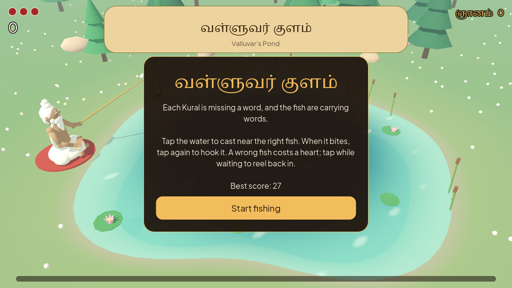
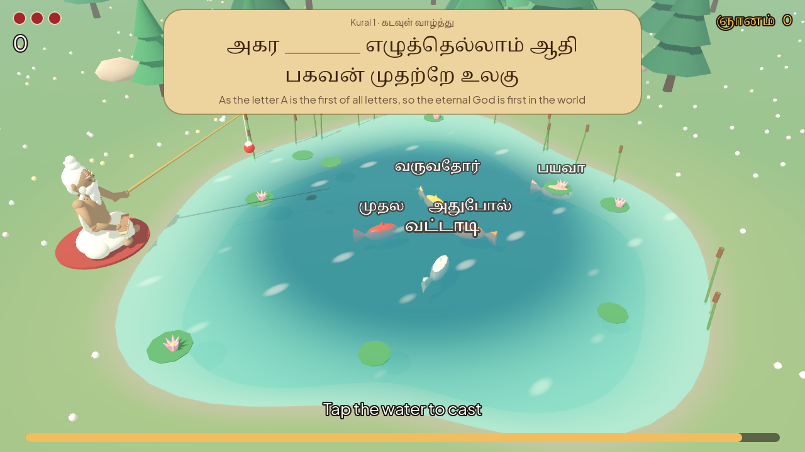
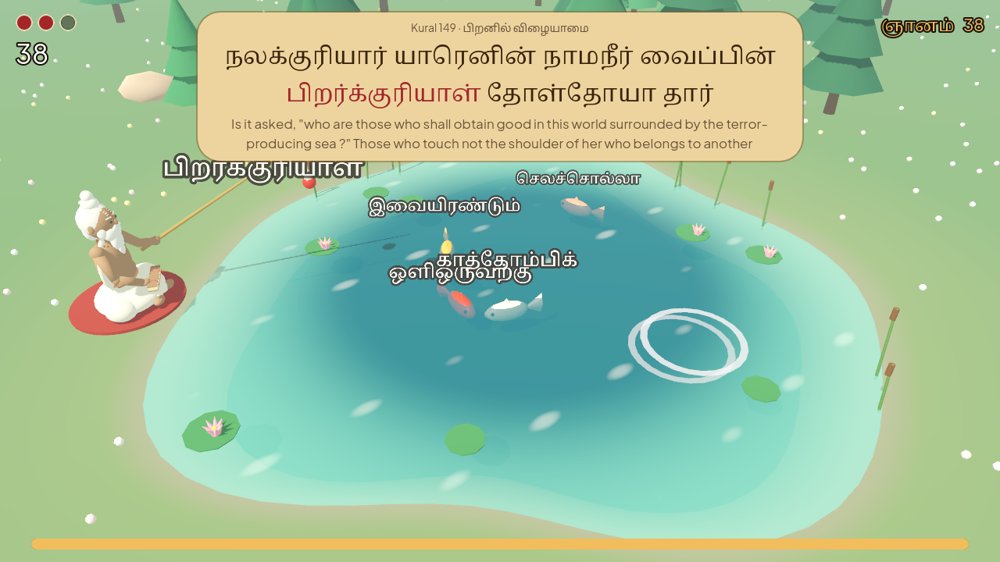

# valluvar's pond (வள்ளுவர் குளம்)

a 3d fishing game built on the thirukkural. thiruvalluvar sits by a lotus pond and fishes for
the word missing from a kural.

**play:** https://adhavan18.github.io/valluvar-pond/



## how to play

1. a kural appears on the palm leaf with one word missing, with its english meaning.
2. each fish carries a word. tap the water near the fish with the right word, and valluvar casts there.
3. when a fish bites, tap again quickly to hook it.
4. the right fish completes the kural. a wrong fish costs one of three hearts.
5. tap while waiting to reel in, if the wrong fish is heading for the bait.



it gets faster as you go:

- a streak of right catches speeds the fish up and shortens the time to hook.
- every fifth kural is a storm round, with rain and double points.
- a golden fish (பொன்) gives back a heart and ten seconds.
- the clock refills a little with every catch. the game ends when it runs out, or when the hearts do.



the hooked word is read aloud in tamil, and so is the kural once it is complete. this uses the
device's own tamil voice, so how it sounds depends on the phone or browser.

all 1,330 kurals are in the game. it starts with the early chapters and opens up as you play.

## add it to a website

the `web/` folder is the finished game for browsers: static files, no server code.

link to the hosted game, or show it inside a page:

```html
<iframe src="https://adhavan18.github.io/valluvar-pond/" width="100%" height="720" style="border:0" allow="autoplay; fullscreen"></iframe>
```

to host it yourself, copy what is inside `web/` to a folder on your site and open `index.html`.
on vercel, import this repository: `vercel.json` already points it at `web/`.

the first load is about 42 mb, because the game engine itself is downloaded. turn on gzip or
brotli for `.wasm` and `.pck` files and it drops to about 10 mb. after the first visit the
browser keeps it, so it opens quickly. no special server headers are needed.

## run and change it

you need [godot 4.7](https://godotengine.org/download).

- open this folder in godot and press play.
- rebuild the web version: `godot --headless --export-release "Web" web/index.html`
  (needs godot's web export templates).
- test the web version: `node serve-web.cjs`, then open http://localhost:4180.

the whole scene is built in code, so there are no scene files to edit:

| file | what it does |
|---|---|
| `scripts/main.gd` | sets up light, camera, the pond and thiruvalluvar, then starts the game |
| `scripts/fishing.gd` | the game: casting, bites, hooking, score, hearts, time, storms |
| `scripts/fish.gd` | one fish: how it swims, chases the bait and carries its word |
| `scripts/world.gd` | the scenery: meadow, pond, trees, rocks, flowers, reeds, lotus |
| `scripts/valluvar.gd` | thiruvalluvar and his rod |
| `scripts/hud.gd` | everything drawn over the scene: the kural, hearts, score, time, panels |
| `scripts/sfx.gd` | all sound, generated in code (there are no audio files), and the tamil read-aloud |
| `scripts/data.gd` | loads the kurals and saves the best score |
| `blender/make_valluvar.py` | builds the thiruvalluvar model: `blender --background --python blender/make_valluvar.py` |

## the full-map branch

the `full-map` branch holds a larger version: thiruvalluvar walks a map and plays two more games,
at a school under a banyan tree and at a scribe's hut. it is unfinished and kept for later.

## credits

- made by [adhavan18](https://github.com/adhavan18) and [md-shameem-dev](https://github.com/Md-Shameem-Dev).
- kural text, transliteration and english meanings: the kts portal (kts.cict.in), central institute
  of classical tamil. this is a student project, not an official cict release.
- fonts: noto serif tamil, noto sans tamil and plus jakarta sans, under the sil open font license
  (`fonts/LICENSE-FONTS.txt`).
- engine: godot. model made with blender.
